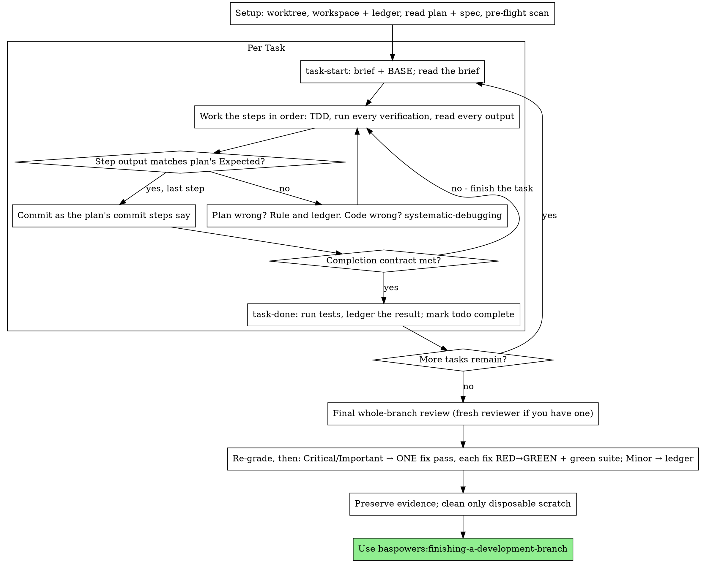

# Executing Plans

Execute the plan yourself, task by task, in this session: no implementer
subagent per task, no reviewer per task. One fresh-context review of the
whole branch at the end.

**Why inline:** Subagent-driven development pays for a fresh implementer
and a fresh reviewer on every task, each re-reading the codebase from zero.
Inline execution pays for one context (yours) plus one reviewer at the end.
What it gives up is a fresh context per task and a second pair of eyes per
task. This skill keeps what those two things bought, by other means: the
brief is the spec, the ledger is your memory, TDD is the per-task gate, and
the final reviewer is the second pair of eyes.

**Core principle:** The plan already did the thinking. Execute it exactly,
prove each step with a test you watched fail and then pass, and leave notes
that survive your own forgetting.

**Narration:** between tool calls, narrate at most one short line — the
ledger and the tool results carry the record.

**Continuous execution:** Do not pause to check in with your human partner
between tasks. Inline execution exists to spend less, not to answer
"should I continue?" after every task. Execute all tasks from the plan
without stopping.

**Rulings, not stalls.** Conflicts, ambiguities, plan defects — decide them.
The spec is the binding authority, the plan is its argument, and your
judgment settles what neither answers. Record every decision in the ledger
as `Ruling: <what you decided> — <why> — <what it costs if wrong>`, and keep
going. Deviating from the plan without a ledgered ruling is a decision made
in secret.

Two limits keep a ruling from becoming a decision made in secret. The ledger supports recovery but does not replace the handoff. Every ruling
reaches your human partner in the final message, and a decision
the repository requires goes through its own decision-record procedure. If none applies, report the rationale without inventing an ADR.
And a ruling that changes the plan's scope or its approved revision is not
yours: report it, and the planner or approver decides. Never edit an approved
plan into a shape its approval did not cover.

Four things stop you, and only these: an irreversible or destructive
operation; a security-sensitive action; a side effect outside this worktree
that norms say you ask about first (a push to a shared branch, a publish);
and a plan so broken that every path forward is a guess even after
baspowers:consulting-cross-model. For those, stop and ask. A merge is never
the agent's action: hand the reviewed head off instead. A change of scope
or of the plan revision also leaves this skill: it returns to the planner or
approver rather than becoming a ruling.

## Repository Executor First

Read the canonical repository workflow before selecting this skill. If the
repository supplies a task-card runner or another required executor, use its
exact command and respect its writable paths. Do not route the card through
Baspowers helpers or dispatch merely because this skill is available.

## When to Use

- You have a plan from baspowers:writing-plans and Native (inline)
  execution was chosen in its Execution Selection.
- Your harness has no subagent tool (see the per-platform references in
  the references listed by the `using-baspowers` skill loader). Never fabricate a dispatch; run
  the plan here.
- Tasks are mostly independent — the same precondition as
  baspowers:subagent-driven-development.

A fully specified plan makes inline execution transcription plus testing:
it runs well on a mid-tier session model, and the one place the most
capable model earns its cost is the final review, which this skill
dispatches separately.

Prefer baspowers:subagent-driven-development when your human partner
wants a review gate on every task, or when the plan is long enough that
its later tasks would run on a compacted context. Inline execution over a
long plan still works — the ledger is what makes it recoverable — but the
last tasks get the least of you.

## The Process



## Setup

Ensure the work happens in an isolated workspace: use
baspowers:using-git-worktrees to create one or verify the existing one.
Never implement directly on main/master; create or enter an isolated
branch/worktree automatically.

Conversation memory does not survive compaction. An inline executor that
loses its place re-implements tasks whose commits already exist — the same
failure as a controller re-dispatching them, paid for in your own context.
Track progress in a ledger file, not only in todos. Harness todos are a
live view; the ledger is what survives compaction.

The workspace and ledger are shared with baspowers:subagent-driven-development
— same directory, same format — so a plan can change executors mid-flight
and the new one resumes from the same ledger.

- Each plan owns a workspace: at skill start, run
  `bash ../subagent-driven-development/scripts/sdd-workspace PLAN_FILE` — it
  prints the plan's git-ignored directory
  (`<repo-root>/.baspowers/sdd/<plan-basename>/`), home to every
  artifact for THIS plan: ledger, briefs, review packages. When the plan uses
  explicit task briefs, add `--brief BRIEF` so the ledger and every helper
  share the workspace keyed by the plan's canonical path and the brief's
  exact revision; a new revision gets a fresh workspace, and a legacy
  path-keyed workspace is left alone. Another plan's directory is never
  yours to read or write.
- Check for this plan's ledger at `<workspace>/progress.md`. If its first
  line names your plan file, tasks with a `Task <N>: complete` line are
  DONE — do not redo them; resume at the first task without one. Their
  commits exist in git even when your context no longer remembers making
  them: after compaction, trust the ledger and `git log` over your own
  recollection. A ledger whose first line names a different plan file is
  another plan's progress: leave it and start your own, fresh.
- Create the ledger with its identity as the first line:
  `# SDD ledger — plan: <plan file path>`.
- `git clean -fdx` will destroy the workspace (it's git-ignored scratch);
  if that happens, recover from `git log`.

Use the plan path and exact revision named by the handoff or required
approval, not the last commit that touched the path. For a tracked plan,
compare the working file byte-for-byte with `git show <approved-commit>:<repo-relative-path>`
(including staged or unstaged changes); for scratch compare the recorded
content digest. If required approval is missing or the selected plan differs,
return to the planner and approver before Task 1. Execution itself needs
request or repository authorization even without a separate approval gate.
Read the named requirements, shared constraints and phase outcomes, and
create todos for the selected tasks. Use the derived brief fields from
`writing-plans`; read any referenced requirements at the pinned revision.

**REQUIRED SUB-SKILL:** load baspowers:test-driven-development now,
before Task 1. It governs every step of every task below; a plan whose
steps already say "write the failing test first" does not exempt you
from reading it.

Before Task 1, scan the plan for conflicts between tasks. Use the consumed and produced interfaces in the briefs or linked plan evidence: for every task that consumes
what an earlier task produces, one ledger row — the two tasks, what one
produces against what the other consumes, and what you found. Tasks that
share nothing get no row; a plan whose tasks share nothing gets the single
line `Pre-flight: no shared interfaces`. Rule on each conflict a row
surfaces with the spec as the binding authority, record the ruling beside
its row, and start Task 1. Each task's own text is checked when you read
its brief, not here.

## The Task Loop

Everything you print, and every tool result, stays resident in your
context for the rest of the session. Redirect long test output to a file
in the workspace and read its tail; read a brief, not the whole plan.

### 1. Take the task

- Run this skill's `bash scripts/task-start PLAN_FILE ID [--brief BRIEF]`.
  It prints the brief path and BASE (the commit the task's range is cut from)
  in one call. Without `--brief`, the script reads `### Task ID` headings,
  keeps nested and non-Task headings in the task body (only the next Task
  heading ends it), ignores Task headings inside fenced text, keeps the old
  numeric delimiters (`Task 1.`, `Task 1—Name`, `Task 1)`), and handles a
  plan with no final newline. For a phase plan, write the
  selected task's brief in scratch with `Plan:`, `Revision:` and `Task:`
  header lines, a blank line, then nonempty task content; pass it as
  `--brief BRIEF`. The helper verifies the plan path, exact revision
  (the committed plan's blob or commit object ID, full or unambiguous
  abbreviated in SHA-1 or SHA-256, or a SHA-256 content digest for scratch),
  task ID and bytes, and rejects a phase document before creating an empty
  brief.
  Either way the brief carries the plan path and revision, the phase and task
  IDs, the exact writable files, the given tests (read-only unless the plan
  says otherwise), the exact test command and the stopping condition. The
  brief contract matters; the extractor does not.
  Read the brief for every task, including ones you remember from setup:
  what you remember is a summary, the brief has the exact values,
  signatures, and test cases.
- Mark the task's todo in_progress.

Every tool call is a turn that re-reads your whole context. Bookkeeping
rides along with work — a ledger append in the same call as the commit,
never in a call of its own.

### 2. Work the steps

The plan's steps are already in RED-GREEN order; follow them in that
order under baspowers:test-driven-development, loaded at setup. A test
step's code is written first and run first. Watching it fail is a step,
not a formality — a test that passes before the implementation exists is
a finding about the test.

A given test runs as it stands. Never edit, delete, skip or loosen one to
reach green; a given test that is itself wrong is a plan change — report it
and let the planner or approver correct it. Write only the files the brief
lists as writable; a needed change outside that list goes back to the plan
owner, not into a quiet edit.

Every step that runs a command has an `Expected:` line. Run the command,
read its output, and compare. Three outcomes:

- **Matches.** Next step.
- **The code is wrong.** Use baspowers:systematic-debugging. Find the
  cause; never patch the symptom to make the step's output match.
- **The plan is wrong** — a step contradicts the spec, an interface from an
  earlier task doesn't match what this task consumes, a command that
  cannot work. Rule on the smallest change that satisfies the spec, ledger
  it as `Task <N>: Ruling: <finding> — <what you decided and why> — <cost if wrong>`, and
  continue. The ruling is carried, not remembered: later tasks that touch
  the same interface read it from the ledger.

Commit as the plan's commit steps say. A task that spans several commits
is fine; BASE is what the review range is cut from, never `HEAD~1`.

### 3. The completion contract

Before a task's ledger line, all of the following are true, with evidence
in this session — not inferred from the diff looking right:

- Every test the brief names exists and ran in this task through the exact
  command the brief names — the project's own make target, script or CI
  command first — and you read the output.
- Every given test the brief lists still exists unmodified unless the brief
  marked it writable, and nothing was written outside the brief's writable
  files.
- The final test run for the task passed — `task-done` is that run, and
  it writes the command and result into the ledger line.
- Every `Expected:` line in the brief was compared against real output.
- The stopping condition is met: nothing past it was attempted.
- For the phase's last task, the phase's `Done when` outcome was observed and
  its output quoted. Green tests do not close a phase.
- Every deviation from the brief has a `Ruling:` line in the ledger.

**REQUIRED SUB-SKILL:** baspowers:verification-before-completion governs
the claim. If any item is missing, the task is not complete: finish it.

### 4. Complete the task

Run this skill's
`bash scripts/task-done PLAN_FILE ID BASE [--brief BRIEF] -- <test command>`
with the test command the brief names for the whole task. It runs the
tests, keeps the full output in the workspace, prints the tail, and — only
if they pass — appends the completion line to the ledger. With `--brief`,
it also re-verifies the plan/brief identity and that BASE still descends
from HEAD before recording anything.

`Task <N>: complete (commits <base7>..<head7>, tests: <command> → <result>)`

A failing run records nothing; the task is not complete. When it records,
mark the todo complete and take the next task.

## Final Review

Run `bash ../subagent-driven-development/scripts/review-package PLAN_FILE MERGE_BASE HEAD`
(MERGE_BASE = the commit the branch actually started from, verified against
the branch's upstream and the repository's default branch — not an assumed
`main`; in a stacked branch it is the parent PR's head, not `origin/main`).
Record MERGE_BASE and HEAD in full and keep the package in the plan workspace
— the helper refuses to overwrite a tracked file. Publish the review evidence
— verdict, both SHAs, package path and output — where the repository
prescribes it, such as the PR body or a named evidence document; when it
prescribes none, keep that record with the plan workspace and name the path.
Review from the file the package printed.

**With a subagent tool:** dispatch the reviewer on the most capable
available model — the whole-branch review is a judgment task — using
baspowers:requesting-code-review's
`code-reviewer.md` reference (load from `requesting-code-review` via the host loader, or read the sibling skill file in a checkout), with the
package path as `[DIFF_FILE]`, the plan and spec paths, the repository's index, template, rubric, applicable gates and environment, and concrete review-focus cases from the plan or handoff, if any (the input classes and failure modes the plan
singled out as most likely to bite — the reviewer checks each deliberately), and a
pointer to the ledger's `Ruling:` lines so it can weigh the calls you
made. Specify the model
explicitly; an omitted model inherits the session's, which may not be the
most capable. This is the one fresh context the whole run buys. Do not
skip it, and do not replace it with your own read of the diff.

Do not hand the reviewer a guessed standard: no assumed label, risk tier,
language, test suite, or copy/organization rule. Its report must separate
exact requirements from evidence-based potential defects, and name the risk
paths it derived from the diff.

**Without a subagent tool:** read code-reviewer.md and perform that review
yourself against the package, as a separate pass after the last task's
ledger line. Write `Final review: self-review (no subagent tool)` to the
ledger, and say so in your final message: a self-review by the author is
weaker than a fresh reviewer, and your human partner decides whether that
is enough before the ready handoff.

Sort the findings before you act on any of them. The reviewer's severity
labels are advice; the gate is yours. Its "Declined to judge" list is
yours too: every line there is a ruling you make and ledger, exactly like
a plan conflict — `Final: Ruling: <behavior the reviewer set aside> —
<what a reasonable person using this software gets, and why that stands
or why it is now a finding> — <cost if wrong>`. Re-grade first, by effect: the
spec is a vision document, and a finding's grade is what a reasonable
person using this software gets if it ships, not whether the spec names
the input that triggers it — a reviewer who set a finding at Minor
because the spec was silent has graded the spec, not the effect. Then:

- **Critical and Important** enter the fix pass.
- **Minor** goes to the ledger as `Final: minor (deferred): <one-liner>`
  and to your final message under "Deferred minors". Minors never enter
  the fix pass, and never become rulings — a ruling is a decision about a
  conflict, not a note that you declined a polish suggestion.

Fix the Critical and Important findings in one pass. Use TDD for each
behavioral correction and run the applicable repository gates on the fix head.
Record test and correction evidence in the prescribed location; follow any
same-PR or history-retention rules, including any permitted empty promotion.

A fix makes the old verdict stale. Request the required current-head review
from an authorized independent reviewer (fresh-context reviewer when permitted,
otherwise hand off to the authorized human or repository review channel).
The author supplies test evidence, not an independent verdict. Until it arrives,
report both heads and mark the fix head unreviewed, not ready. This review gate
is distinct from the one-pass fix budget.

A finding you decide not to fix is a ruling — `Final: Ruling: <finding> —
<why the code stands> — <cost if wrong>` — and reaches your human partner
in the rulings list. There is no second fix pass.

## Finish

Before you delete anything, collect every ledger line containing
`Ruling:` into your final message under "Rulings I made", in the order you
made them, each with what it costs if wrong, and every `minor (deferred)`
line under "Deferred minors". Both lists are exhaustive. Your final
message communicates the decisions and deferred findings even when the
workspace is retained. Do not rely on the ledger alone for handoff.
Link any decision record created under repository rules.

Preserve the workspace whenever it contains the only copy of any review
verdict, diff, or correction evidence. Before any authorized cleanup, verify
that required records and their paths remain accessible elsewhere. If the
repository gives no other evidence location, leave the workspace intact.

Use baspowers:finishing-a-development-branch.

## Common Rationalizations

| Excuse | Reality |
|--------|---------|
| "I remember what Task N says" | You remember a summary. The brief has the exact values. Read it. |
| "The plan's code is right, skip watching the test fail" | A test you never saw fail proves nothing. It is one step. Run it. |
| "I'll run the full suite at the end instead of per step" | Per-step runs are how you learn which step broke it. The end-of-task run is the contract, not a substitute. |
| "The plan is wrong here, I'll just do the right thing" | Do the right thing and ledger the ruling. Unledgered deviation is a decision made in secret. |
| "I'll write the ledger lines after a few tasks" | Compaction does not wait for a convenient moment. One line per task, in the same message as the commit. |
| "Let me check in before the next task" | Inline exists to spend less. Progress prompts spend your partner's time instead. Only the four stops stop you. |
| "I read my own diff carefully; the final reviewer is redundant" | Same author, same blind spots. The reviewer is the only fresh context this run buys. |
| "Tests should pass, the change was trivial" | "Should" is not evidence. The contract requires the command and its output. |
| "Subagents are slow and expensive, I'll skip the final review too" | Inline already removed the per-task reviewers. One review of the whole branch is the floor, not the ceiling. |
| "The reviewer said Minor, so it's Minor" | The label graded the spec's silence. Grade what the person gets. Re-grade, then gate. |
| "The fix is obvious, no need for a failing test first" | The failing test is the only proof the finding was real and is now gone. Without it you have a diff and a hope. |
| "The review was clean before the fix pass" | The fixes made a new head. That verdict covers the old tree; record both heads and leave the ready claim to a review of the current one. |
| "Green tests and a docs-only diff are enough to finish" | Review evidence is its own claim, and the repository's rules decide what docs need. Neither is inferred from a suite or a file extension. |
| "I'll put the blocking fix in a follow-up PR" | If required by repository rules, keep the correction and evidence on this PR. |
| "I'll fix the minors too while I'm in there" | Every minor you fix is a test, a fix, and a suite run your partner did not ask for. Ledger them; your partner decides. |

## Example Workflow

```
You: I'm using the executing-plans skill to implement this plan inline.

[Setup: worktree verified]
[Read plan once: <plan path> @ <plan revision>; approval matches; spec read]
[Resolve workspace: sdd-workspace <plan path> — no ledger inside, fresh start]
[Pre-flight scan: 2 shared-interface rows, 4 self-consistency rows, clean; written to ledger]
[Create todos for all tasks]

Task 1: Hook installation script

[Write explicit Task 1 brief with Plan/Revision/Task header; task-start plan 1 --brief BRIEF → brief read; BASE a1b2c3d]
[Step 1: write failing test — written]
[Step 2: run it — FAIL: install_hook not defined. Matches Expected.]
[Step 3: implement — written]
[Step 4: run it — PASS 1/1. Matches Expected.]
[Step 5: commit — d4e5f6a]
[Contract: tests ran, output read, no deviations]
[task-done plan 1 a1b2c3d --brief BRIEF -- npm test -- hooks → ledger: Task 1: complete (commits a1b2c3d..d4e5f6a, tests: npm test -- hooks → 1/1 pass)]

Task 2: Recovery modes

[task-start plan 2 → brief read; BASE d4e5f6a]
[Step 2: run failing test — FAIL, but on an import error: Task 1 exported
 installHook, brief consumes install_hook]
[Ruling: brief's consumer name is a typo against Task 1's Produces block;
 use installHook — Ledger: Task 2: Ruling: install_hook → installHook — matches Task 1 Produces — cost if wrong: one rename]
[Steps 2-5 as planned; commit b7c8d9e]
[task-done plan 2 d4e5f6a -- npm test -- recovery → ledger: Task 2: complete (commits d4e5f6a..b7c8d9e, tests: npm test -- recovery → 8/8 pass)]

...

[After all tasks, each phase's Done when observed and quoted: review-package plan MERGE_BASE HEAD; dispatch code-reviewer, most capable model]
Reviewer: One Important finding — progress reporting interval hardcoded. Two Minor.
[Re-grade: Important stands; minors → ledger as deferred]
[Fix pass: test_progress_interval_configurable RED → extract PROGRESS_INTERVAL → GREEN; suite 12/12; commit]
[Ledger: Final: fixed hardcoded interval — test_progress_interval_configurable RED→GREEN, suite 12/12]

Rulings I made:
- Task 2: install_hook → installHook (brief typo; cost if wrong: one rename)

Deferred minors:
- README lacks a usage example
- recovery.js could split verify/repair into two files

[Preserve workspace and evidence paths for handoff]

Using baspowers:finishing-a-development-branch.
```
